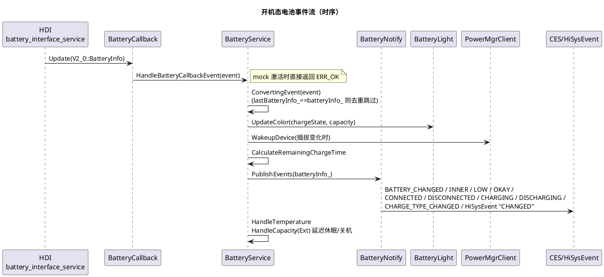

# 架构设计及约束

## 架构设计

### 设计原则

| 原则 | 描述 | 理由 |
|---|---|---|
| HDI 单一真相源 | 所有电池状态变更必须经 `BatteryCallback` 上报进入 `BatteryService`，业务侧禁止直接构造 `BatteryInfo`（AGENTS.md 架构不变量；实现见 `services/native/src/battery_service.cpp` 的 `ConvertingEvent`） | 保证状态一致性与事件时序，避免多源数据冲突 |
| 客户端零业务状态 | `BatterySrvClient`（`interfaces/inner_api/native/include/battery_srv_client.h`）仅做 IPC 转发与代理缓存，查询失败返回哨兵值 | 状态集中在服务端，客户端无需处理状态同步 |
| 权限服务端校验 | `SetBatteryConfig` 等写操作在服务端 `Permission::IsSystem()` + `POWER_OPTIMIZATION` 校验（`battery_service.cpp:720`） | 客户端不可信，IPC 边界是唯一可靠的防线 |
| 事件同步分发 | `HandleBatteryCallbackEvent` → `HandleBatteryInfo` → `PublishEvents` 在 HDI 回调内同步完成，不引入异步乱序 | 订阅者期望按上报顺序收到事件（AGENTS.md 项目特定陷阱） |
| 特性开关条件编译 | 7 个 `declare_args()` 开关 + `defines` 宏（`batterymgr.gni:16-30`），裁剪低电量阈值、charger、充电音效、通知、无线充电、CLI 等 | 适配不同产品形态，控制 ROM/内存（bundle.json 标称 1024KB/2048KB） |
| 关机充电独立运行 | `charger/` 不依赖 `services/native/` 开机服务，直读 sysfs、独立 SA 配置与资源 | 关机充电场景无法访问开机服务，二者互斥运行 |
| 延迟加载重资源 | 充电音效 `libcharging_sound.z.so`、通知 `libbattery_notification.z.so`、插件 `batteryplugin/autorun` 均按需 `dlopen` | 降低常驻内存与启动耗时，隔离崩溃影响 |

### 逻辑架构

自上而下五层（源码位置均相对仓根）：

1. **应用接口层**（多语言绑定）
   - ArkTS：`frameworks/napi/src/battery_info.cpp`（模块名 `batteryInfo`，容量/充电/健康等属性查询）、`frameworks/napi/src/charger.cpp`（模块名 `charger`，ChargeType）、`frameworks/napi/src/system_battery.cpp`（模块名 `battery`，`getStatus`）；`frameworks/ets/taihe/` 为 taihe FFI 生成产物。
   - C（NDK）：`interfaces/kits/c/ohbattery_info.h` + `frameworks/capi/battery_info/ohbattery_info.cpp`（`OH_BatteryInfo_GetCapacity`/`GetPluggedType`）。
   - CJ：`frameworks/cj/src/battery_info_ffi.cpp`。
2. **客户端 SDK 层**：`BatterySrvClient`（`interfaces/inner_api/native/include/battery_srv_client.h` + `frameworks/native/src/battery_srv_client.cpp`），`DelayedRefSingleton` 单例，`Connect()` 惰性获取 SA 3302 代理并挂 `BatterySrvDeathRecipient` 死亡通知。
3. **IPC 层**：`services/zidl/IBatterySrv.idl` 定义 18 个方法（`[ipccode 0]` 起编），构建期生成 `IBatterySrv_proxy/stub`；`BatteryService` 同时继承 `SystemAbility` 与 `BatterySrvStub`（`services/native/include/battery_service.h:51`）。
4. **服务端层**（SA 3302，进程 `powermgr`，FFRT 队列 `battery_service`）
   - `BatteryService`：状态持有者（`batteryInfo_`/`lastBatteryInfo_`、阈值、mock 标志、`remainTime_` 等），生命周期回调 `OnStart/OnStop/OnAddSystemAbility/OnRemoveSystemAbility`。
   - `BatteryCallback`：HDI 上报入口，静态 `eventCb_` 转发（`services/native/src/battery_callback.cpp`）。
   - `HdiServiceStatusListener`：HDI 上下线监听，上线时 FFRT 任务重新 `RegisterBatteryHdiCallback` + `InitBatteryInfo`（`battery_service.cpp:371-418`）。
   - `BatteryNotify`：事件分发（`services/native/src/battery_notify.cpp`）。
   - `BatteryConfig`：配置解析（`services/native/src/battery_config.cpp`，单例 + mutex）。
   - `BatteryLight`：指示灯；`BatteryDump`：hidumper；`ChargingSound`（`services/native/src/charging_sound.cpp`）；`BatteryXCollie`（`utils/native`，HiCollie 看护）。
   - 扩展点：`ModuleMgrScan("/system/lib{,64}/batteryplugin/autorun")` 插件目录 + `utils/hookmgr` 钩子（`BATTERY_UEVENT_CHECK`/`BATTERY_PUBLISH_EVENT`）。
5. **HDI/内核层**：`HDI::Battery::V2_0::IBatteryInterface`（`battery_interface_service`，`sa_profile/3302.json` 声明 `min_hdi_proxy_version: ["libbattery_proxy_2.0.z.so"]`）；light/input/display HDI。

**关机充电分支**：`charger/src/charger.cpp` 的 `main` → `ChargerThread::StartThread` → `BatteryThread::LoopingThreadEntry`（epoll 监听 uevent socket + timerfd，`charger/include/battery_thread.h`）→ 每周期 `UpdateBatteryInfo`（`PowerSupplyProvider` 直读 `/sys/class/power_supply`）→ `HandleStates`（充电状态/电源键/背光）。UI 栈为 ui_lite + graphic_utils_lite（`charger/include/charger_graphic_engine.h`、`charger/src/dev/` DRM/fbdev 适配）。

### 非功能设计

| 场景类别 | 方案设计 |
|---|---|
| HDI 重启恢复 | `RegisterHdiStatusListener` 经 HDI ServiceManager 注册 `ServStatListenerStub`；`battery_interface_service` 上线 → FFRT 任务重新 `Register` 回调并 `InitBatteryInfo` 全量刷新；下线 → `UnRegister` 并置空接口。SA 层面另有 `OnRemoveSystemAbility(DEVICE_SERVICE_MANAGER_SA_ID)` 兜底重连（`battery_service.cpp:145-193`）。注册失败按 1000ms 延迟重试（`RETRY_TIME`） |
| 服务死亡自愈（客户端） | `BatterySrvClient::Connect` 为代理对象添加 `BatterySrvDeathRecipient`；`OnRemoteDied` → `ResetProxy` 清空代理，下次查询自动重连 |
| 并发安全 | 服务端 `std::shared_mutex mutex_` 保护 `iBatteryInterface_` 与 `batteryInfo_`（写：HDI 注册/回调注册；读：各 `Get*Inner`）。`BatteryNotify` 内 `std::mutex` 保护 once 去重状态；`BatteryConfig` 单例 + 静态 `std::mutex` |
| 关机任务被休眠打断 | 低电量延迟关机期间创建 `RunningLock`（"ShutDownGuard"，`RUNNINGLOCK_BACKGROUND_TASK`，超时 90000ms）防止 S3/ULSR 中断任务（`battery_service.cpp:646-675`）；订阅 `COMMON_EVENT_ENTER/EXIT_HIBERNATE` 取消定时器 |
| 阻塞与看护 | 每个 IPC 入口构造 `BatteryXCollie`（HiCollie watchdog，`utils/native/include/battery_xcollie.h`）；HDI 回调内禁止阻塞 IO（AGENTS.md 禁止事项），长操作交 FFRT |
| 内存安全 | 充电音效链路启用 jemalloc `MemoryGuard`（`CONFIG_USE_JEMALLOC_DFX_INTF`）；`dlclose` 危险库用 `RTLD_NODELETE` 规避重 dlopen 崩溃（`battery_notify.cpp:354-369` 注释） |
| 多 SA 共进程 | SA 3301/3302/3303/3308 共享 `powermgr` 进程；本服务 `OnStart` 延迟到依赖 SA 上线再初始化对应能力（灯光等 MISCDEVICE、公共事件等 CES） |
| 部件可裁剪 | `batterymgr.gni` 检测 hisysevent/miscdevice/display/light/graphic_surface/ui_lite/graphic_utils_lite/config_policy 等 part 存在性，输出 `HAS_*_PART` 宏控制编译 |

## 架构约束

- **HDI 访问必须经服务端封装**
  - **what**：所有 `IBatteryInterface` 调用集中在 `BatteryService`（`Get*Inner`、`RegisterBatteryHdiCallback`、`SetBatteryConfigInner` 等），客户端与 charger 子模块不得直接持有 HDI 代理（charger 走 sysfs）。
  - **why**：绕过封装会破坏"单一真相源"与权限校验，产生状态不一致与越权写配置。
- **HDI 回调内禁止阻塞**
  - **what**：`HandleBatteryCallbackEvent` 全链路（含 `PublishEvents`）为同步调用，仅做状态转换、内存操作与 IPC 发布；延迟关机等长任务投递 FFRT 队列 `g_queue`。
  - **why**：HDI 上报频率高，阻塞会丢失后续事件并拖垮 HDI 服务线程（AGENTS.md 禁止事项）。
- **IPC ABI 契约不可破坏**
  - **what**：`IBatterySrv.idl` 的 `[ipccode N]` 只能追加不能复用/调整；`BatteryInfo` 字段顺序、`*.map` 版本脚本已导出符号（`frameworks/capi/libohbattery_info.map`、`interfaces/inner_api/libbatterysrv_client.map`、`utils/hookmgr/libbattery_hookmgr.map`、`services/libbattery_notification.map`、`frameworks/cj/libcj_battery_info_ffi.map` 等）不可降级；NDK C 接口签名稳定。
  - **why**：旧客户端按码值路由 IPC，错位会调用错误接口；结构体布局变化会让 C 消费者崩溃（AGENTS.md 需确认后再修改）。
- **`min_hdi_proxy_version` 不可降级**
  - **what**：`sa_profile/3302.json` 声明 `libbattery_proxy_2.0.z.so`。
  - **why**：服务端使用了 V2_0 接口（`SetBatteryConfig`、`GetChargeType` 等），降级 HDI 代理导致符号缺失与上报中断。
- **charger 与开机服务互斥且隔离**
  - **what**：`charger/` 编译产物为独立 `charger` 可执行程序（`charger/BUILD.gn` 的 `ohos_executable("charger")`，受 `battery_manager_feature_enable_charger` 控制），不链接 `libbatteryservice.z.so`，资源（`charger/resources/`、`charger/sa_profile/animation.json`）独立。
  - **why**：关机充电时 samgr/CES 未运行，任何对开机服务的依赖都会失败（AGENTS.md 架构不变量）。
- **powermgr 进程内禁止长耗时同步操作**
  - **what**：本进程与 power/thermal/display 共享，耗时操作走 FFRT（如 HDI 重试、低电量任务）。
  - **why**：单 SA 阻塞会拖死同进程全部系统服务（AGENTS.md 项目特定陷阱）。
- **状态变更必须可观测**
  - **what**：电池变化触发 HiSysEvent "CHANGED"、关键路径 `BATTERY_HILOGI` 日志；事件定义集中在 `batterymgr.yaml`。
  - **why**：DFX 是电池问题定位的唯一线上手段，删除即失去观测（AGENTS.md 禁止事项）。
