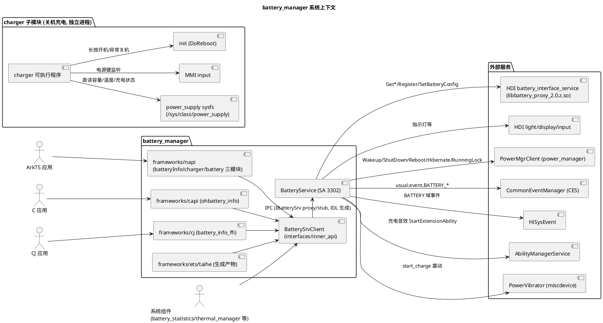

# 业务背景

## 应用定位

### 核心职责
battery_manager（部件名 `@ohos/battery_manager`，powermgr 子系统，系统能力 `SystemCapability.PowerManager.BatteryManager.Core`）实现 OpenHarmony 电池服务，以系统服务 SA 3302 运行于 `powermgr` 进程（库 `libbatteryservice.z.so`，见 `sa_profile/3302.json`、`bundle.json`）。处理对象是电池/充电相关的实时状态与配置，核心职责：

- **电池信息查询**：容量、电压、温度、充电状态、健康状态、技术类型、瞬时/平均电流、剩余/总能量、充电类型、剩余充电时间等（`services/native/src/battery_service.cpp` 中 `Get*Inner` 系列）。
- **充放电状态上报**：把 HDI 上报的电池变化转换为 `usual.event.BATTERY_*` 公共事件、`BATTERY_CHANGED_INNER` 内部事件和 HiSysEvent 事件分发给系统与应用（`services/native/src/battery_notify.cpp`）。
- **充电辅助体验**：电池指示灯（`services/native/src/battery_light.cpp`）、充电震动（`utils/native` 的 `PowerVibrator` + `battery_vibrator.json`）、充电音效（特性开关，经 `power_dialog` 的 ServiceExtensionAbility 播放）。
- **电源保护动作**：插拔唤醒设备、温度越界关机、低电量延迟休眠/关机（`battery_service.cpp` 的 `HandleTemperature`/`HandleCapacity`/`HandleCapacityExt`）。
- **场景化电池配置**：按 `sceneName` 读写/查询充电配置，透传至 HDI（`IBatterySrv.idl` 的 `SetBatteryConfig`/`GetBatteryConfig`/`IsBatteryConfigSupported`）。
- **关机充电模式**：独立 `charger` 可执行程序（`charger/`），在关机充电场景下直读 sysfs 驱动充电动画、LED、背光与按键（长按电源键开机）。

### 职责边界（本组件不负责）
- **HDI 驱动接口**：电池数据采集与充电控制由 `drivers_interface_battery`（`IBatteryInterface` V2_0）、`drivers_interface_light` 等仓维护，本仓只是消费方（AGENTS.md 架构不变量："不要直接修改 HDI 接口"）。
- **开关机/休眠执行**：本服务通过 `PowerMgrClient` 发起 `ShutDownDevice`/`RebootDevice`/`Hibernate`/`WakeupDevice` 请求，真正的电源动作由 power_manager 执行。
- **充电音效播放与弹窗 UI**：由 `power_dialog` 应用的 `ChargeSoundPlayerExtension` 及通知服务承担，本服务仅发起 `StartExtensionAbility`/`StopExtensionAbility` 和发布通知（`services/native/src/battery_notify.cpp` 的 `TriggerChargingSound`）。
- **公共事件订阅管理**：由 common_event_service 提供，本服务只做发布（以及订阅休眠事件用于取消关机任务）。
- **CJ 语言绑定维护**：`frameworks/cj/` 由 CJ 团队维护；`frameworks/ets/taihe/` 为 taihe FFI 生成产物；`tools/ohos-batteryManager/` 为独立 npm 包（CLI），均不属于本团队日常维护范围（AGENTS.md"非本项目维护的目录"）。
- **电池统计与热管理**：耗电统计由 battery_statistics、温控策略由 thermal_manager 负责，它们只是本服务的下游消费者。

## 系统上下文

数据流要点（均有代码依据）：
- 所有开机态电池数据变化均由 HDI 上报进入 `BatteryCallback::Update`（`services/native/src/battery_callback.cpp:24`），服务端 `ConvertingEvent` 转换为内部 `BatteryInfo` 后经 `BatteryNotify::PublishEvents` 分发；客户端 `BatterySrvClient` 只做 IPC 转发，不持有业务状态。
- 关机充电模式不经过上述链路，`ChargerThread` 通过 `PowerSupplyProvider` 直读 sysfs（`charger/src/power_supply_provider.cpp`）。

## 核心输入

| 输入类别 | 来源 | 主要内容/参数 | 触发时机 |
|---|---|---|---|
| HDI 电池事件 | `battery_interface_service` 回调 `BatteryCallback::Update(event)` | `HDI::Battery::V2_0::BatteryInfo`（capacity/pluggedType/chargeState/temperature/uevent 等 17 字段） | 电池/充电状态变化时驱动主动上报 |
| HDI 服务状态 | `HdiServiceStatusListener::OnReceive` | `ServiceStatus{serviceName, deviceClass, status}` | battery_interface_service 上下线（HDI 重启） |
| IPC 查询/配置请求 | `IBatterySrv` stub（18 个方法，`services/zidl/IBatterySrv.idl`） | 容量/电压/温度等出参查询；`SetBatteryConfig(sceneName, value)` 等 | 应用或系统组件调用 |
| 配置文件 | `etc/battery/battery_config.json`（经配置策略 `GetOneCfgFile` 解析，vendor/system 均可放置）；`etc/battery/battery_vibrator.json` | SOC 阈值、温度阈值、灯光配置、开机公共事件配置、弹窗/通知配置、无线充电开关 | 服务启动 `InitConfig` / charger `InitLackPowerCapacity` |
| SA 上线事件 | `OnAddSystemAbility`（MISCDEVICE/CES/DEVICE_SERVICE_MANAGER） | 系统能力 ID | 各 SA 就绪/移除时 |
| 休眠公共事件 | `BatteryCommonEventSubscriber::OnReceiveEvent` | `COMMON_EVENT_ENTER_HIBERNATE`/`EXIT_HIBERNATE` | 低电量关机任务等待期内系统进入/退出休眠（特性开关开启时） |
| 系统参数 | `system::GetBoolParameter("const.power.enable_s4")`、`GetParameter("ohos.boot.minisys.mode")` | 是否允许休眠、是否蓬莱极简模式 | 低电量处理决策时 |
| hidumper 调试命令 | `BatteryService::Dump(fd, args)` | `-i` 信息、`-u` 模拟拔出、`--capacity/--uevent`、`-r` 复位（非用户版本） | 开发者执行 `hidumper -s 3302` |

## 核心输出

| 输出类别 | 接收方 | 业务作用 |
|---|---|---|
| CommonEvent `usual.event.BATTERY_CHANGED` | 订阅电池变化的应用/CES | 携带 soc/chargeState/healthState/pluggedType/voltage/temperature/technology/present/capacityLevel 等 Want 参数（`battery_info.h` 的 `COMMON_EVENT_KEY_*`） |
| CommonEvent `usual.event.BATTERY_CHANGED_INNER` | 持有 `ohos.permission.POWER_OPTIMIZATION` 的系统订阅者（如 thermal_manager） | 补充 maxCurrent/maxVoltage/nowCurrent/chargeCounter 内部字段 |
| CommonEvent BATTERY_LOW/OKAY、POWER_CONNECTED/DISCONNECTED、CHARGING/DISCHARGING、CHARGE_TYPE_CHANGED | 应用 | 边沿触发（once 去重）的状态迁移通知 |
| CommonEvent 自定义事件（`usual.event.battery*` 前缀）与通知/弹窗 | 系统应用、通知中心 | uevent 动作 `sendcustomevent`/`sendpopup` 驱动，经 `libbattery_notification.z.so` 发布通知（特性开关开启时） |
| HiSysEvent `BATTERY` 域（如 "CHANGED"） | HiView/DFX | 电池状态统计与故障观测（`batterymgr.yaml` 声明） |
| 电源动作请求 | power_manager | 插拔唤醒（`WAKEUP_DEVICE_PLUG_CHANGE`）、温度越界关机（"TemperatureOutOfRange"）、低电量休眠/关机（"LowCapacity"）、uevent 动作关机（"POWEROFF_CHARGE_DISABLE"）/重启 |
| 指示灯颜色 | light HDI（经 sensors miscdevice） | 充电时按 SOC 区间亮红/黄/绿 |
| 震动/充电音效 | miscdevice、power_dialog 扩展能力 | 插入充电器时的触觉与听觉反馈 |
| 充电动画与背光/LED（关机充电） | 显示设备（DRM/fbdev）、LED | 关机充电 UI 与长按电源键开机交互 |
| IPC 查询应答 | 客户端进程 | 各 `Get*` 出参值；失败返回 `INVALID_BATT_*` 哨兵值或 `BatteryError` |
